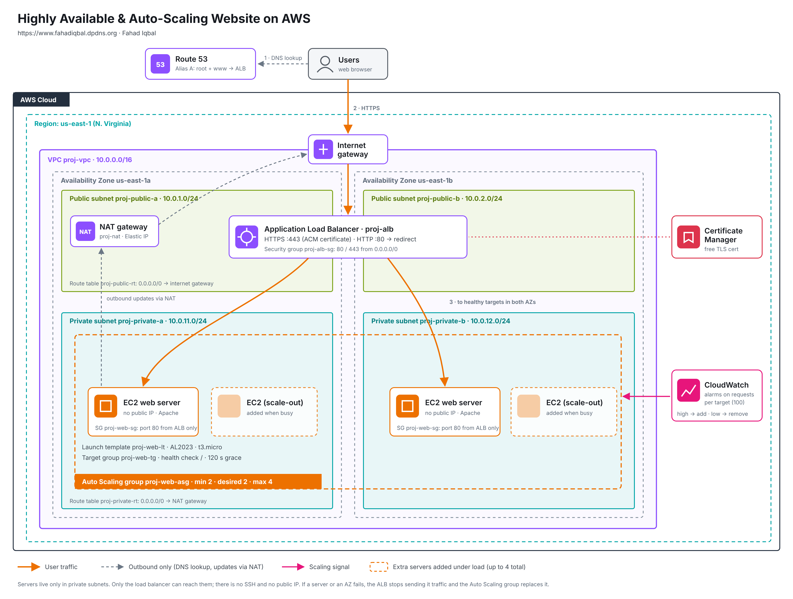

# Highly Available & Auto-Scaling Website on AWS

## What I built
A website that stays online when a server or an Availability Zone fails,
and adds servers automatically when traffic grows. It runs on my own domain
with HTTPS: **https://www.fahadiqbal.dpdns.org**

## AWS services
VPC (2 AZs, public + private subnets), Internet & NAT Gateway,
Application Load Balancer, Target Group, Launch Template,
Auto Scaling Group (2-4 x t3.micro), Route 53, ACM (HTTPS), CloudWatch

## Architecture
| Layer | Setup |
|---|---|
| Region | us-east-1 (N. Virginia), AZs us-east-1a and us-east-1b |
| Network | Custom VPC `10.0.0.0/16`: 2 public subnets (`10.0.1.0/24`, `10.0.2.0/24`) and 2 private subnets (`10.0.11.0/24`, `10.0.12.0/24`) |
| Internet access | Internet gateway for the public subnets; NAT gateway so the private servers can download updates without being reachable from the internet |
| Load balancer | Internet-facing ALB in the public subnets. HTTPS:443 with an ACM certificate; HTTP:80 redirects to HTTPS |
| Servers | Amazon Linux 2023, t3.micro, in the **private** subnets, launched from a launch template with a user data script |
| Auto Scaling | Min 2, desired 2, max 4. Target tracking: 100 ALB requests per target. ELB health checks on |
| Security | ALB security group allows 80/443 from the internet. Server security group allows port 80 **only from the ALB security group**. No SSH, no public IPs |
| DNS | Route 53 hosted zone with Alias A records for the root domain and `www`, pointing to the ALB |

## How it works
1. Users open https://www.fahadiqbal.dpdns.org (Route 53 -> ALB)
2. The ALB sends each request to a healthy server in AZ a or AZ b
3. Servers run in private subnets; only the ALB can reach them
4. Auto Scaling adds servers above 100 requests per server, and removes them when traffic drops

## Tests
- **Self-healing:** terminated a running server. The ALB stopped sending it traffic, the site stayed online, and the Auto Scaling group launched a replacement automatically.
- **Scale out:** sent traffic from CloudShell (20 parallel `curl` loops, about 6,000 requests per minute). The CloudWatch alarm fired and the group scaled from 2 to 4 servers.
- **Scale in:** after the traffic stopped, the low alarm fired and the group scaled back from 4 to 2.

## Demo video
[Watch the demo](YOUR-VIDEO-LINK)

## Screenshots
See the [`screenshots`](screenshots) folder: VPC resource map, healthy targets in 2 AZs, the site over HTTPS, Auto Scaling activity history, and the ALB request graph during the load test.

## Files
| File | What it is |
|---|---|
| `architecture.png` | Architecture diagram (draw.io) |
| `user-data.sh` | Launch template user data: installs Apache and builds the page, showing which server and AZ answered |
| `screenshots/` | Evidence from the build and tests |

## What I learned
- **Placeholders break shell commands.** Pasting `URL=http://<ALB-DNS-NAME>/` set the URL to just `http://`, because bash reads `<` as input redirection. My load test sent no traffic until I put the real address in and tested it with `curl` first.
- **Scale-in needs data, not silence.** With zero traffic the ALB publishes no request metrics, so the low alarm stays in "Insufficient data" and the group never scales in. Target tracking treats missing data as unknown, not as quiet.
- **Timeout vs refused tells you where to look.** `ERR_CONNECTION_TIMED_OUT` means a security group is silently dropping the traffic (here: port 443 on the ALB). "Connection refused" means the traffic arrived but nothing was listening.

## Cost & clean-up
Built and deleted the same day; total cost about $[x].
