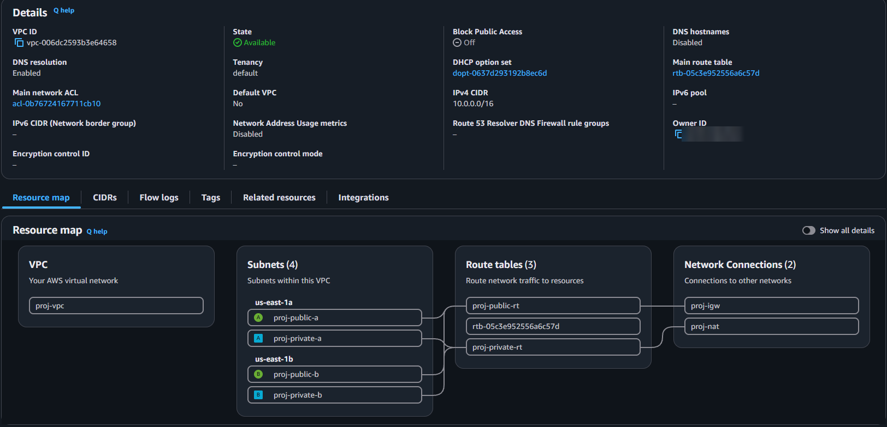
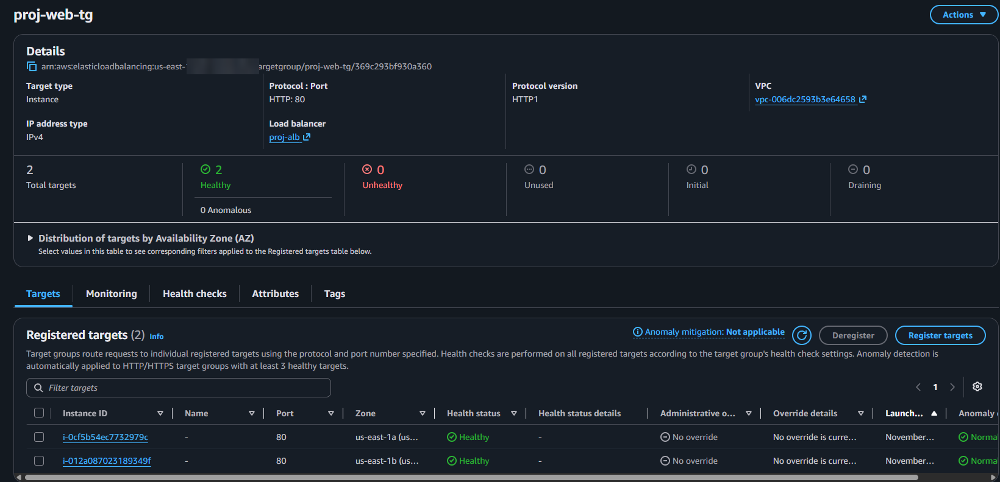
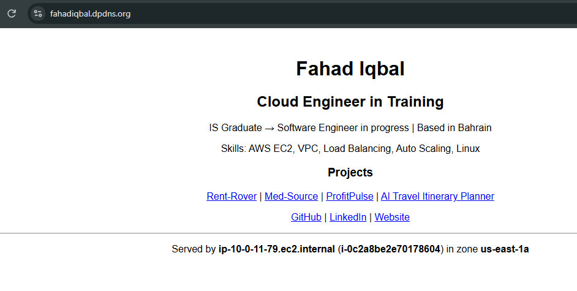
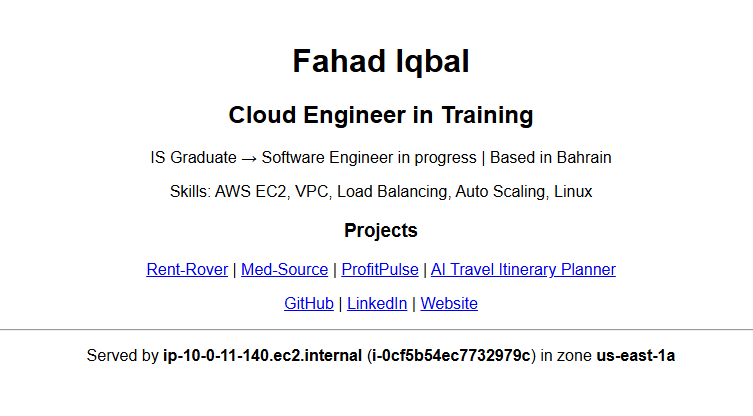
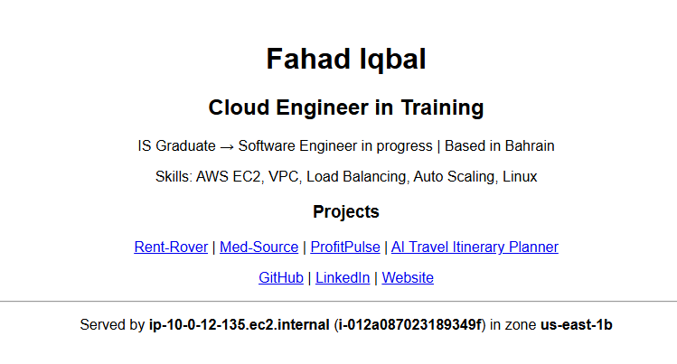
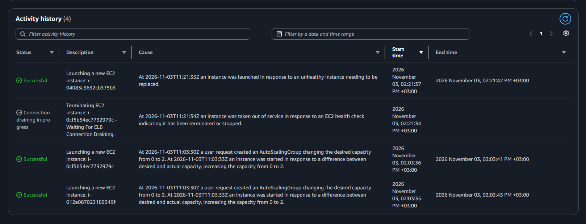
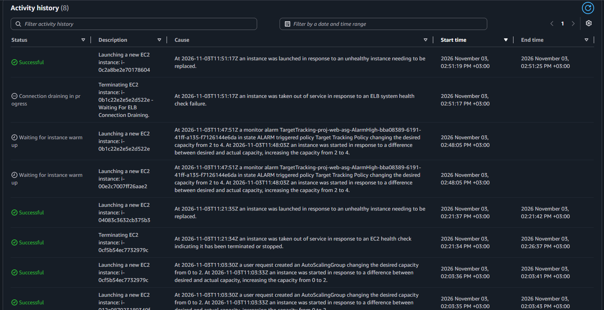
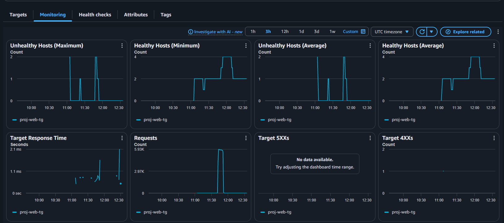

# Highly Available & Auto-Scaling Website on AWS

## What I built
A website that stays online when a server or an Availability Zone fails,
and adds servers automatically when traffic grows. It runs on my own domain
with HTTPS: **https://www.fahadiqbal.dpdns.org**

## AWS services
VPC (2 AZs, public + private subnets), Internet & NAT Gateway,
Application Load Balancer, Target Group, Launch Template,
Auto Scaling Group (2-4 x t3.micro), Route 53, ACM (HTTPS), CloudWatch

## Architecture
| Layer | Setup |
|---|---|
| Region | us-east-1 (N. Virginia), AZs us-east-1a and us-east-1b |
| Network | Custom VPC `10.0.0.0/16`: 2 public subnets (`10.0.1.0/24`, `10.0.2.0/24`) and 2 private subnets (`10.0.11.0/24`, `10.0.12.0/24`) |
| Internet access | Internet gateway for the public subnets; NAT gateway so the private servers can download updates without being reachable from the internet |
| Load balancer | Internet-facing ALB in the public subnets. HTTPS:443 with an ACM certificate; HTTP:80 redirects to HTTPS |
| Servers | Amazon Linux 2023, t3.micro, in the **private** subnets, launched from a launch template with a user data script |
| Auto Scaling | Min 2, desired 2, max 4. Target tracking: 100 ALB requests per target. ELB health checks on |
| Security | ALB security group allows 80/443 from the internet. Server security group allows port 80 **only from the ALB security group**. No SSH, no public IPs |
| DNS | Route 53 hosted zone with Alias A records for the root domain and `www`, pointing to the ALB |

## How it works
1. Users open https://www.fahadiqbal.dpdns.org (Route 53 -> ALB)
2. The ALB sends each request to a healthy server in AZ a or AZ b
3. Servers run in private subnets; only the ALB can reach them
4. Auto Scaling adds servers above 100 requests per server, and removes them when traffic drops

## Tests
- **Self-healing:** terminated a running server. The ALB stopped sending it traffic, the site stayed online, and the Auto Scaling group launched a replacement automatically.
- **Scale out:** sent traffic from CloudShell (20 parallel `curl` loops, about 6,000 requests per minute). The CloudWatch alarm fired and the group scaled from 2 to 4 servers.
- **Scale in:** after the traffic stopped, the low alarm fired and the group scaled back from 4 to 2.

## Demo video
[Watch the demo on YouTube](https://youtu.be/UE1kWhR-lLY)

## Screenshots

**Custom VPC: 4 subnets across 2 AZs, internet gateway and NAT gateway**

**Target group: 2 healthy servers, one in each AZ**

**Website on my own domain over HTTPS**

**Each request is served from a different AZ**
| Zone a | Zone b |
|---|---|
|  |  |

**Self-healing: a stopped server is replaced automatically**

**Scale out: the CloudWatch alarm changes desired capacity from 2 to 4**

**Load test: about 6,000 requests, healthy hosts rise to 4**

## Files
| File | What it is |
|---|---|
| `architecture.png` | Architecture diagram (draw.io) |
| `user-data.sh` | Launch template user data: installs Apache and builds the page, showing which server and AZ answered |
| `screenshots/` | Evidence from the build and tests |

## What I learned
- **Security groups can reference each other.** The web servers allow port 80 only from the load balancer's security group, not from an IP range. The ALB's IPs change over time, so referencing its security group keeps the rule correct without any updates, and the servers stay unreachable from the internet.
- **Private servers still need a way out.** Servers in private subnets have no public IP, so they install software through a NAT gateway: outbound only, nothing can connect in. That's also why a new server takes a little longer to boot, which matters for the health check grace period. Too short, and Auto Scaling replaces servers before they're ready.
- **Target tracking is simple to set up but deliberate in how it reacts.** One number (100 requests per server) creates two CloudWatch alarms automatically. Scaling out took about 3 minutes; scaling in is slower on purpose (about 15 minutes of low traffic), and it needs real data. With zero traffic the metric isn't published, so the group won't scale in.
- **Alias records beat CNAMEs for AWS targets.** A Route 53 Alias works on the root domain (`fahadiqbal.dpdns.org`), follows the load balancer's changing IPs automatically, and its queries are free. The same hosted zone also validated the free ACM certificate through DNS.

## Cost & clean-up
Built, tested and deleted the same day. Total cost: under $1 (about $0.27 billed so far; AWS charges can take up to a day to appear).
